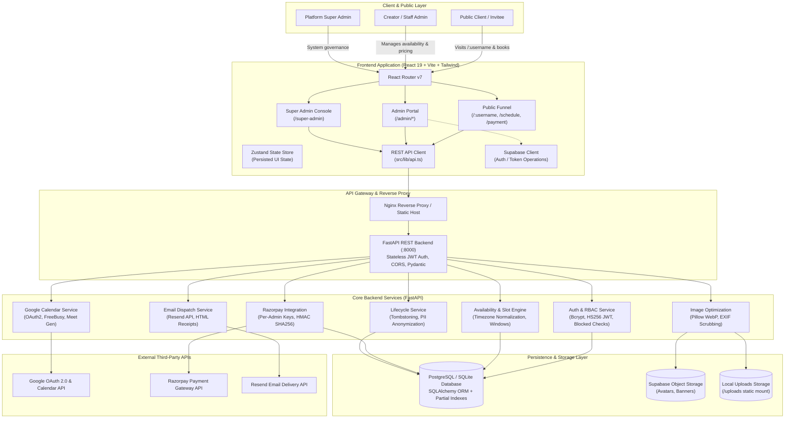
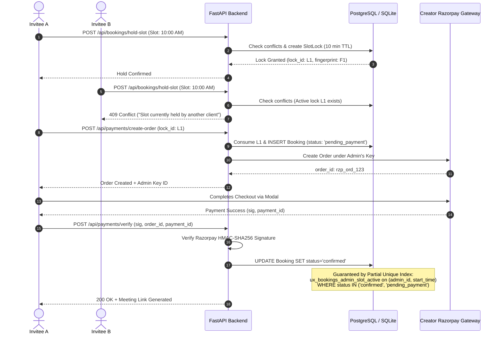
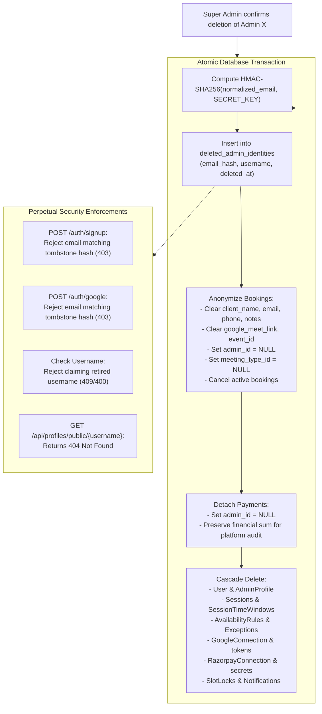
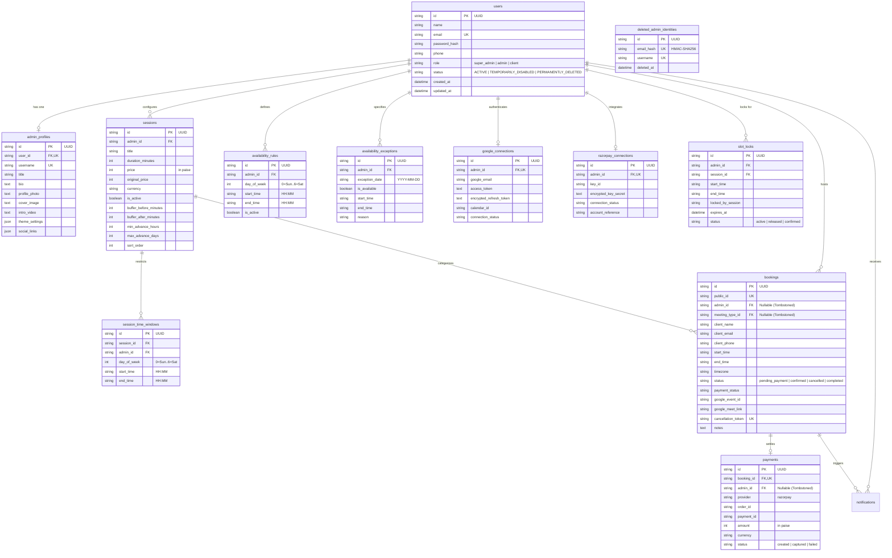
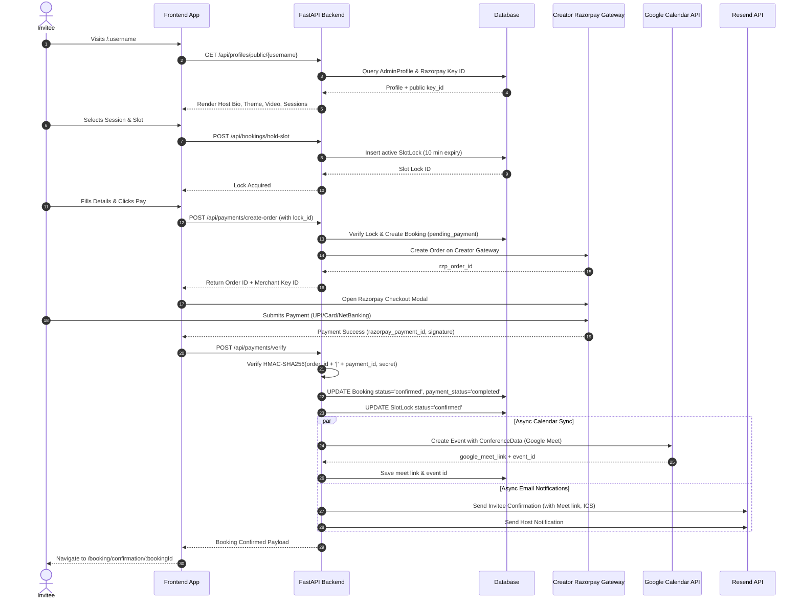
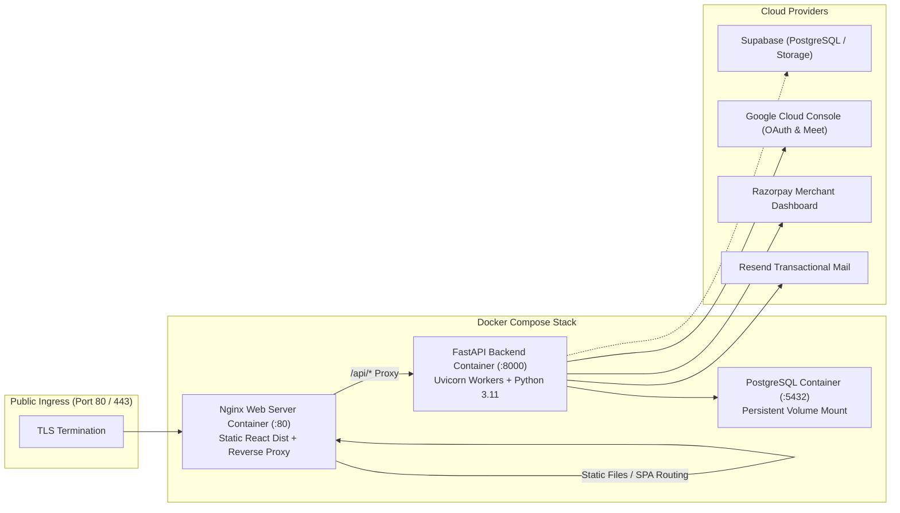

# BookMyMeet — Complete System Architecture Specification

## 1. Executive Summary & Domain Overview

**BookMyMeet** is an enterprise-ready, multi-tenant 1:1 appointment scheduling and creator monetization platform inspired by SuperProfile-style bio and scheduling engines. 

### Core Value Proposition
- **Multi-Admin Financial & Brand Autonomy**: Each creator/staff admin operates an isolated vanity booking portal (`/:username`) with personalized branding, video introductions (YouTube / Vimeo), custom theme gradients, and independent session offerings.
- **Direct Peer-to-Merchant Payment Flow**: Creators link their individual Razorpay merchant accounts. Client session fees flow **100% directly** into each creator's gateway with zero platform intermediary deductions or escrow holds.
- **Automated Calendar & Meet Synchronization**: Per-admin Google Calendar OAuth 2.0 integration performs real-time busy slot deductions and automatically generates Google Meet video conference rooms upon booking confirmation.
- **Strict Concurrency & Anti-Double-Booking Guarantees**: A two-tiered locking architecture combines a distributed temporary slot-hold mechanism (`SlotLock`) with an authoritative database-level partial unique index to eliminate race conditions during checkout.
- **Privacy-Preserving Lifecycle Management**: Permanent account deletion anonymizes historical booking and payment ledgers while establishing cryptographically hashed tombstones (`deleted_admin_identities`) to prevent identity spoofing or re-registration.

---

## 2. High-Level Architecture Diagram



---

## 3. Technology Stack Decomposition

| Domain | Technology / Library | Architectural Responsibility |
| :--- | :--- | :--- |
| **Frontend Framework** | React 19 + TypeScript | Component tree, hooks, high-performance DOM rendering |
| **Build & Bundling** | Vite 8 | Development HMR and optimized production bundling |
| **Styling & Design System** | Tailwind CSS 4 + Lucide Icons + Radix UI | Glassmorphism, creator theme CSS variables, accessible primitives |
| **State Management** | Zustand (`persist` middleware) | Client state, offline fallback, optimistic UI caching |
| **Frontend Routing** | React Router DOM v7 | Root vanity URLs (`/:username`), scoped scheduling, admin sub-routes |
| **Date & Time Utilities** | date-fns + date-fns-tz | Timezone calculations, slot formatting (`Asia/Kolkata` baseline) |
| **Backend Framework** | FastAPI (Python 3.11+) | Async REST API, OpenAPI docs generation, typed schemas |
| **Application Server** | Uvicorn ASGI | High-concurrency asynchronous HTTP request processing |
| **ORM & Database Layer** | SQLAlchemy 2.0 | Declarative schema models, transactions, partial unique constraints |
| **Database Engines** | PostgreSQL 15+ / SQLite | Persistent relational storage, index-backed conflict enforcement |
| **Security & Cryptography** | Passlib (Bcrypt) + Cryptography (Fernet) | Salted password hashing, AES-256 encrypted credential storage |
| **Token Verification** | PyJWT / python-jose | Stateless HS256 bearer tokens (7-day validity, live DB role check) |
| **Payment Gateway** | Razorpay Python SDK & Checkout JS | Dynamic creator checkout, order generation, HMAC verification |
| **Calendar & Video Conf** | Google Calendar API v3 | FreeBusy interval deduction, Google Meet room provisioning |
| **Email Delivery** | Resend API / SMTP Fallback | Transactional booking confirmations, ICS calendar attachments |
| **Image Processing** | Pillow (PIL) | Dynamic resizing, WebP conversion, GPS/EXIF metadata stripping |
| **Containerization** | Docker & Docker Compose | Multi-stage Nginx for frontend, Python-slim backend, PostgreSQL |
| **Alternative Stack** | Supabase (PostgreSQL RLS + Deno Edge) | Standalone mirror architecture for serverless/edge deployments |

---

## 4. Architectural Patterns & Core Subsystems

### 4.1. Three Overlapping Frontend Data Paths
The frontend application maintains resilience across heterogeneous deployment topologies by structuring data ingestion into three channels:
1. **Canonical REST Client (`src/lib/api.ts`)**: Direct HTTP interface to FastAPI (`/api/*`). Serves as the single source of truth for public profile resolution, slot calculation, booking creation, order generation, and admin settings.
2. **Supabase Client (`src/lib/supabase.ts`)**: Direct database and auth connection utilized for magic links, token-based public actions (cancel, reschedule, booking status), and direct admin dashboard subscriptions.
3. **Zustand Offline Store (`src/stores/bookingStore.ts`)**: Client-side persisted store (`bookmymeet-platform-state-v4`). Acts strictly as an ephemeral UI state container without fake seed data, hydrating from backend API responses upon authentication.

### 4.2. Concurrency Control & Double-Booking Protection
Preventing conflicting bookings across concurrent users is guaranteed through a defense-in-depth model:



#### Key Concurrency Safeguards:
- **Distributed Slot Lock (`slot_locks`)**: Holds slots for 10 minutes during checkout. Requires matching `session_fingerprint` to release, eliminating cross-client lock hijacking.
- **Database Partial Unique Index**:
  ```sql
  CREATE UNIQUE INDEX ux_bookings_admin_slot_active
  ON bookings (admin_id, start_time)
  WHERE status IN ('confirmed', 'pending_payment');
  ```
  Even if concurrent requests bypass application logic, the database engine enforces atomicity and rejects collisions with an `IntegrityError` (mapped to HTTP 409).
- **Abandoned Booking Expiry Sweep**: Handled by `services/booking_slots.py`. Uncompleted checkouts older than `ABANDONED_CHECKOUT_MINUTES = 20` are released automatically to prevent artificial slot depletion.

---

### 4.3. Multi-Admin Financial Isolation
Each creator maintains an isolated payment channel to eliminate platform custodial liabilities:

```mermaid
flowchart TD
    subgraph CreatorSettings["Creator Admin Settings (/admin/settings)"]
        AdminInput["Admin enters Key ID & Key Secret"]
        EncryptSecret["AES-256 Fernet Encryption"]
        StoreConn["Save to razorpay_connections Table"]
        AdminInput --> EncryptSecret --> StoreConn
    end

    subgraph PublicFunnel["Client Booking Funnel"]
        VisitProfile["Client visits /:username"]
        FetchPublicProfile["GET /api/profiles/public/{username}"]
        ExposePublic["Returns public razorpay_key_id<br/>(Secret strictly suppressed)"]
        
        VisitProfile --> FetchPublicProfile --> ExposePublic
        
        CheckoutPage["PaymentCheckoutPage.tsx"]
        ExposePublic --> CheckoutPage
        
        DynamicInit["Init window.Razorpay({<br/>key: admin.razorpay_key_id,<br/>name: admin.full_name,<br/>theme: admin.theme_settings.button_color<br/>})"]
        CheckoutPage --> DynamicInit
    end

    subgraph VerificationBackend["Payment Verification (/api/payments/verify)"]
        ClientPayload["Client sends razorpay_payment_id, order_id, signature"]
        FetchSecret["Backend loads admin's encrypted_key_secret"]
        DecryptSecret["Fernet Decrypt Key Secret"]
        ComputeHMAC["Compute HMAC-SHA256(order_id + '|' + payment_id)"]
        VerifyMatch{"HMAC matches signature?"}

        ClientPayload --> FetchSecret --> DecryptSecret --> ComputeHMAC --> VerifyMatch
        VerifyMatch -->|Yes| ConfirmBooking["Status -> 'confirmed'<br/>Trigger Meet & Email"]
        VerifyMatch -->|No| Reject400["400 Bad Request (Invalid Signature)"]
    end
```



---

### 4.4. Availability Calculation Engine
Availability generation (`backend/app/api/availability.py`) combines working hours, Google Calendar events, and per-meeting constraints:

$$\text{Bookable Slots} = \Big(\text{Working Hours} \cap \text{Session Time Windows}\Big) \setminus \Big(\text{Google FreeBusy} \cup \text{Occupying Bookings} \cup \text{Active Slot Locks} \cup \text{Exceptions}\Big)$$

1. **Working Hours Evaluation**: Evaluates `availability_rules` for the target weekday. Uses modulo arithmetic `(weekday + 1) % 7` to bridge Python's ISO week (Monday=0) to DB schema (Sunday=0).
2. **Session Time Window Intersection**: If `session_time_windows` are specified for a session, bookable hours are restricted strictly to the intersection with general working hours.
3. **Google FreeBusy Subtraction**: Real-time query to Google Calendar API v3 using the creator's decrypted refresh token. If Google Calendar is disconnected or fails, availability fails closed to prevent double-booking.
4. **Buffer & Advance Notice Padding**: Pads bookings with `buffer_before_minutes` and `buffer_after_minutes`. Enforces `min_advance_hours` (minimum lead time) and `max_advance_days` (booking horizon).

---

### 4.5. Admin Deletion, Anonymization & Tombstoning
Permanent deletion (`DELETE /api/super-admin/admins/{id}?confirm=true`) executes in a single atomic transaction:



---

## 5. Database Schema & Entity Relationship Model



---

## 6. End-to-End Booking & Settlement Lifecycle



---

## 7. Security Architecture & Threat Mitigation

### 7.1. Cryptographic Secrets Protection
- **Symmetric Encryption (AES-256 Fernet)**: Sensitive third-party credentials (`razorpay_connections.encrypted_key_secret` and `google_connections.encrypted_refresh_token`) are encrypted at rest using a dedicated 32-byte urlsafe base64 key (`ENCRYPTION_KEY`). Plaintext secrets are never stored in the database or serialized into logs.
- **HMAC Signatures**: Razorpay webhooks and client verification requests validate HMAC-SHA256 signatures before confirming payment or executing calendar provisioning.

### 7.2. Authentication & RBAC Integrity
- **Stateless JWT**: Standard HS256 tokens (`SECRET_KEY`), with a 7-day expiration.
- **Dynamic Role Verification**: Tokens carry only `{sub: user_id, exp}` and intentionally omit role claims. Role verification (`get_current_admin`, `get_current_super_admin`) performs a fresh database lookup on every request, ensuring instant revocation if an admin is disabled or deleted.

### 7.3. SSRF & Ingestion Hardening (SuperProfile Importer)
- SuperProfile profile imports validate URLs against strict hostname allowlists (`superprofile.bio`).
- Private, loopback, link-local, and reserved IP ranges (RFC 1918 / RFC 3927 / IPv6 equivalents) are rejected prior to DNS resolution to prevent Server-Side Request Forgery.

### 7.4. File Upload & Image Sanitization
- Uploaded avatars and cover images undergo strict server-side validation via Pillow.
- Formats are converted to modern WebP format with capped dimensions (max 1200px width/height).
- EXIF, GPS coordinates, camera metadata, and malicious embedded scripting tags are scrubbed upon ingestion.

---

## 8. Deployment & Operational Topology



### Environment Configuration Matrix

| Variable | Scope | Purpose |
| :--- | :--- | :--- |
| `DATABASE_URL` | Backend | PostgreSQL / SQLite connection string (Required, no default) |
| `SECRET_KEY` | Backend | HS256 JWT signing secret & HMAC tombstone key |
| `ENCRYPTION_KEY` | Backend | AES-256 Fernet encryption key for OAuth tokens & API secrets |
| `SUPER_ADMIN_EMAIL` | Backend | Initial bootstrap Super Admin credentials |
| `SUPER_ADMIN_PASSWORD` | Backend | Initial bootstrap Super Admin password |
| `GOOGLE_CLIENT_ID` | Backend | Google OAuth 2.0 Client ID for Calendar & Meet |
| `GOOGLE_CLIENT_SECRET` | Backend | Google OAuth 2.0 Client Secret |
| `GOOGLE_REDIRECT_URI` | Backend | OAuth callback endpoint (`/api/google/callback`) |
| `RESEND_API_KEY` | Backend | API Key for transactional email delivery |
| `VITE_API_URL` | Frontend | Target FastAPI base endpoint (`http://localhost:8000/api`) |
| `VITE_RAZORPAY_KEY_ID` | Frontend | Fallback global Razorpay key (overridden by admin keys) |
| `VITE_SUPABASE_URL` | Frontend | Supabase project URL for storage & edge auth |
| `VITE_SUPABASE_ANON_KEY` | Frontend | Supabase anonymous public key |
